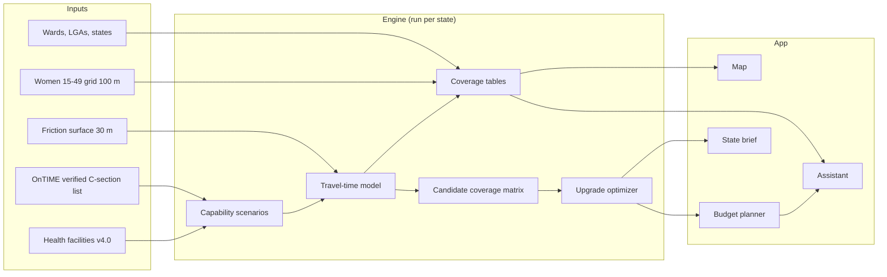

# Reach120 architecture

## Shape of the system

Reach120 is a batch engine plus a thin app. The heavy geospatial work runs once per state and
writes files. The app reads those files, so it stays fast and cheap to host.



## Components

Each pipeline step is one module in `src/reach120/` and one command (`reach120 <step> --state Kano`).
Outputs go to `outputs/<state>/`; see `store.py` for the exact layout.

| Step | Module | Job | Writes |
|---|---|---|---|
| prepare | `prepare.py`, `inputs.py`, `tiffzip.py` | Cut the state plus a 50 km margin out of the zipped friction surfaces; population, wards and facilities for the state | `inputs/` |
| scorecard | `scorecard.py` | Score each capability definition against OnTIME's verified list (national, once) | `_national/capability_scorecard.*` |
| travel-time | `access.py`, `dijkstra.py` | Travel time to the nearest capable facility, per scenario and mode | `access/ttpop_*.tif`, `access/tt30_*.tif` |
| coverage | `coverage.py`, `display.py` | Women within 30, 60 and 120 minutes by ward, LGA and state; map images | `coverage/`, `display/` |
| reach | `planning.py` | Demand points, candidate upgrades, and what each candidate would reach | `planning/demand.parquet`, `candidates.parquet`, `reach_mixed.npz` |
| plan | `plan.py`, `optimize.py` | Plans within a budget and the budget curve | `planning/curve_*.parquet`, `plans/*.json` |
| validate | `validate.py` | OnTIME travel times, optional OSRM spot-check, DHS check, sensitivity | `validation/validation_report.md` |
| brief | `brief.py` | One-page PDF | `brief/` |
| app | `app/` | Overview, Map, Planner, Ask, Method and limits | nothing |
| assistant | `assistant.py`, `numbercheck.py` | Tool-calling answers with a number check | `assistant_log.jsonl` |

## Methods

### 1. Which facilities can do a C-section

The facility data has `facility_type`, `facility_level`, `facility_ownership` and `functional`,
but no surgery field. Three scenarios bracket the truth:

| Scenario | Facility types counted | Count nationwide (v4.0) |
|---|---|---|
| Strict | General Hospital, Federal Medical Center, Teaching/Tertiary Hospital | 1,056 |
| Base | Strict, plus Specialist Hospital and Cottage Hospital | 2,208 |
| Loose | Base, plus facilities typed plain "Hospital" (mostly private) | 8,239 |

Facilities marked Not-Functional or Closed are dropped in every scenario.

**Calibration.** The OnTIME list holds 2,021 facilities across 15 cities whose C-section capacity
was verified, and 94% of them are private. Each is matched to GRID3: by shared national facility
code, otherwise by the distinctive words of the name, accepted up to 1.5 km apart when the names
agree strongly (the two sources' coordinates for one hospital often differ by kilometres). GRID3
holds duplicate records, so matches count in both directions. For each scenario the scorecard
reports how many verified facilities it catches and how many of the facilities it counts, inside
the study area, are not on the verified list. With `default: auto` the scenario with the best
balance (F1) becomes the default. A fourth view, **public only**, stays available because
private care is out of reach for many women; it is not nested in the others, so the planner
leaves it out.

### 2. Travel time

- **Input:** the GRID3 friction surface: 30 m cells, UTM zone 32N, minutes per metre, with rivers
  as barriers. Two versions: mixed (vehicle on passable roads, walking elsewhere) and walking only.
- **Reading the surface:** each zip holds one 6.39 GB uncompressed, tiled GeoTIFF that this
  laptop cannot unpack. `tiffzip.py` streams the zip once to find the tile index (cached), then
  once more keeping only the tiles of the state window.
- **Method:** multi-source Dijkstra from all capable facilities at once, on an 8-connected grid.
  A step from cell a to b costs distance × (friction_a + friction_b) / 2, the rule of
  scikit-image's `MCP_Geometric`, so results are in minutes. It is implemented in `dijkstra.py`
  with numba, because the planner needs two things off-the-shelf routines lack: a cap on the
  search, and exact pruning (below). Tests check it against SciPy's Dijkstra on random grids.
- **Window:** the state plus a 50 km margin, so that hospitals across the state line and roads
  that leave and re-enter the state are counted.
- **Resolution:** native 30 m. Averaging to 100 m blends roads into the bush beside them and
  inflates travel times.
- **Barriers:** no-data cells are impassable.
- **Facilities** are moved onto the nearest passable cell within 300 m.

One test guards the units: a straight 30 km road at 60 km/h must come out at 30 minutes.

### 3. Coverage

Resample travel time onto the population grid (3 arc-seconds, about 92 m), taking the **median**
of the 30 m cells inside each population cell. Not the mean: the surface treats rivers as
barriers, which leaves a few 30 m cells enclosed with travel times in the thousands of minutes,
and one of them can drag a population cell's mean past two hours. In Kano the mean put 4,379
women "beyond two hours by vehicle"; the median puts 109. Burn ward IDs onto the same grid. A single pass then gives, for each ward, the women within
30, 60 and 120 minutes. Sum wards to LGAs and the state. The WorldPop README advises against
reading single cells, so nothing below ward level is reported.

### 4. Choosing upgrades within a budget

This is a maximal covering problem with a budget.

- **Demand points** `i`: women more than 120 minutes away, summed into blocks of 5 × 5
  population cells (about 460 m), with one weight per planner scenario. Each block stands at a
  30 m cell, inside its most populous uncovered population cell, that is itself beyond 120
  minutes. A stand-in on the near side of a river barrier would make the women behind it look
  easy to reach, and would also weaken the pruning bound below.
- **Transport modes:** the planner runs for both. In Kano no upgrade helps by vehicle (only 109
  women are beyond two hours, in isolated pockets), so the brief plans for travel on foot, where
  1.9-2.1 million women are beyond two hours; it picks the mode with more women beyond the target
  and says so.
- **Candidates** `j`: operating facilities in the state that are not capable under the strictest
  scenario: hospitals (cost tier "hospital"), other secondary-level facilities ("secondary"), and
  the public primary health centre in each LGA with the most uncovered women within 10 km
  ("phc"). Eye, dental and diagnostic facilities are excluded. Capped at 250 by uncovered women
  within 30 km.
- **Reach** `a_ij = 1` if demand point `i` is within 120 minutes of candidate `j`. One search per
  candidate on the 30 m grid, stopped at 120 minutes and pruned exactly: with T the travel time
  to the nearest existing hospital (strict scenario) and L the smallest T among demand points, a
  cell k can lie on a path of at most 120 minutes to a demand point only if
  T(k) ≥ d(j, k) + (L − 120), by the triangle inequality. Cells failing that are never expanded,
  so each search covers only the area where the candidate would beat existing hospitals. Every
  run re-checks a few candidates without pruning and stops if any result differs.
- **Cost** `c_j`: from a cost table by upgrade type. These are placeholders, shown as such on
  every screen.

```
maximise    Σ w_i · y_i
subject to  y_i ≤ Σ a_ij · x_j      for every demand point i
            Σ c_j · x_j ≤ Budget
            x_j ∈ {0, 1},  0 ≤ y_i ≤ 1
```

Solved exactly with OR-Tools CP-SAT, after merging demand points that share the same covering
candidates (same answer, much smaller model). A greedy solver (best women-per-naira first, with
the best-single-site check) runs alongside for two reasons: it gives a stable ranked list, and
the gap between the two shows how much the exact method adds. A third, naive ranking (most
uncovered women within 30 km in a straight line) shows what modelling roads and rivers adds. The
best set at ₦2bn is not always the ₦1bn set plus more, so the app shows the ranked list and the
exact optimum side by side. Women reached are credited to the nearest chosen site.

Sweeping the budget gives a curve of women reached against naira spent. The point where the curve
flattens is the main message of each brief.

### 5. Sensitivity

Every headline number is reported as a range across the three capability scenarios and the two
friction surfaces.

## Assistant

The assistant is a tool-calling loop on a free-tier language model, reached through any
OpenAI-compatible endpoint (Groq's free tier by default). It has no knowledge of its own about
any state: it can only call these functions.

The state is fixed by the app, not chosen by the model.

| Tool | Returns |
|---|---|
| `access_summary(scenario, mode)` | Women within and beyond each threshold |
| `area_table(level, scenario, mode, sort, limit)` | Worst-served wards or LGAs |
| `rank_upgrades(budget_naira, scenario, tier_costs_naira)` | The chosen facilities, cost, women reached, with greedy and straight-line comparisons |
| `compare_runs(run_a, run_b)` | Differences between two saved plans |
| `facility_lookup(query, limit)` | Matching facilities' records |
| `build_brief(run_id)` | The brief as a file |

Guardrails:

- Every number in an answer must appear in a tool result from the same turn. A check runs before
  the answer is shown; a failed check triggers one retry, then a plain "I could not verify that".
- Tool arguments are validated against a schema in the app's own code before any tool runs. A
  free-tier model will sometimes send malformed arguments; those are rejected and retried once.
- At most five tool calls per question, so a day's questions fit inside a free quota.
- Each answer ends with the scenario and assumptions it used.
- When the quota is used up or the model is unreachable, the Ask page says so. The map, planner
  and briefs do not depend on it.
- Every question, tool call and answer is logged.

The brief is a fixed template filled from the results file, with its sentences built by rule. It
needs no language model.

## App and hosting

- **Streamlit**, five pages: Overview, Map, Planner, Ask, Method and limits.
- **Map:** travel-time bands over a base map (or wards shaded by the share of women beyond 120
  minutes), capable hospitals as points, recommended upgrades in orange. Hover for details.
- **Planner:** scenario picker, budget slider, editable cost table. The optimizer runs on demand
  in seconds because reach is precomputed. The budget curve has hover tooltips and a table view.
- **Colours:** travel-time bands take one blue ramp, light to dark (validated as an ordinal ramp);
  chart lines take the first three categorical colours, validated in light and dark mode. Orange
  means the recommended plan on both the map and the chart.
- **Hosting:** Hugging Face Spaces (Docker). `reach120 bundle --state Kano` writes a folder with
  the app, its code and the state's small outputs. The app needs no GDAL: everything it reads is
  parquet, JSON, PNG or NumPy.

## Repository layout

```
01-reach120/
├── pyproject.toml
├── config/            settings.yaml, scenarios.yaml, costs.yaml
├── src/reach120/
│   ├── cli.py         reach120 prepare | scorecard | travel-time | coverage | reach | plan | validate | brief | all | ask | bundle | app
│   ├── config.py, store.py, geo.py, inputs.py, tiffzip.py
│   ├── prepare.py     step 1
│   ├── scorecard.py   capability stand-in against OnTIME
│   ├── dijkstra.py    compiled least-cost search with cap and exact pruning
│   ├── access.py      step 2
│   ├── coverage.py, display.py   step 3
│   ├── planning.py    step 4: demand, candidates, reach
│   ├── optimize.py, plan.py      step 5
│   ├── validate.py    step 6
│   ├── brief.py       step 7
│   └── assistant.py, numbercheck.py
├── app/               streamlit_app.py, appdata.py, views/
├── tests/             test_dijkstra, test_tiffzip, test_optimize, test_coverage, test_scorecard, test_assistant
└── outputs/<state>/   generated, not in git
```

## Compute

Measured on this laptop (16 GB memory, 4 cores) for Kano with its 50 km margin: 9,458 × 10,931
cells = 103 million.

| Step | Time | Notes |
|---|---|---|
| Find each zip's tile index | 2 min per surface, once | One streamed pass through 6.39 GB, then cached |
| Cut the friction windows | 1.5 min per surface | Streams the zip up to the last tile it needs |
| Travel time, one scenario and mode | 2-3.5 min, about 1.5 GB memory | Multi-source search over all 103 million cells |
| Candidate reach, 131 candidates on foot | 6 s | Median 71,656 cells explored per search, thanks to the pruning |
| Budget sweep, 31 budgets × 3 scenarios × 2 modes | 15 s | CP-SAT on merged demand points |
| Disk | 750 MB per state | Mostly the two friction windows (280 MB each) |

A national run is 37 state runs, not one big one.

## Known limits

- Capability is inferred, not observed, outside the 15 OnTIME cities, and the scorecard shows
  facility type is a weak stand-in (catch rates 6-63%).
- Some facility records have no coordinates and cannot be placed: 264 of Kano's 2,122, of which
  2 to 41 are hospitals depending on the definition.
- The friction surface assumes dry-season roads. Wet-season access is worse; FloodAhead's flood
  layer could feed a wet-season scenario later.
- No traffic. Expect the model to be faster than Google's times inside big cities.
- Travel time is not the only barrier: cost, referral delays and staffing are outside the model.
- The friction surface and wards are CC BY-SA 4.0, so published derived maps carry that licence.
