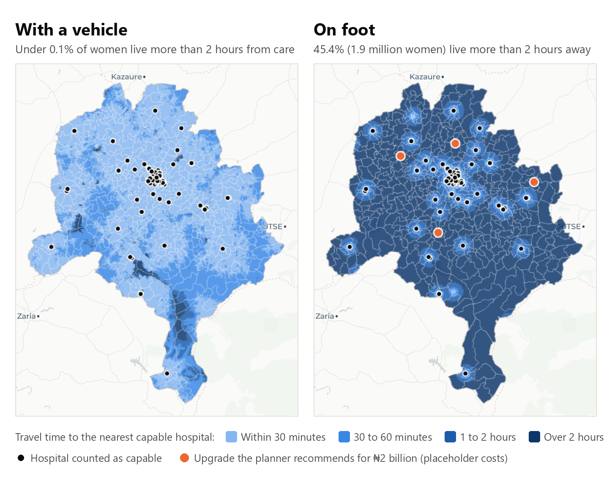
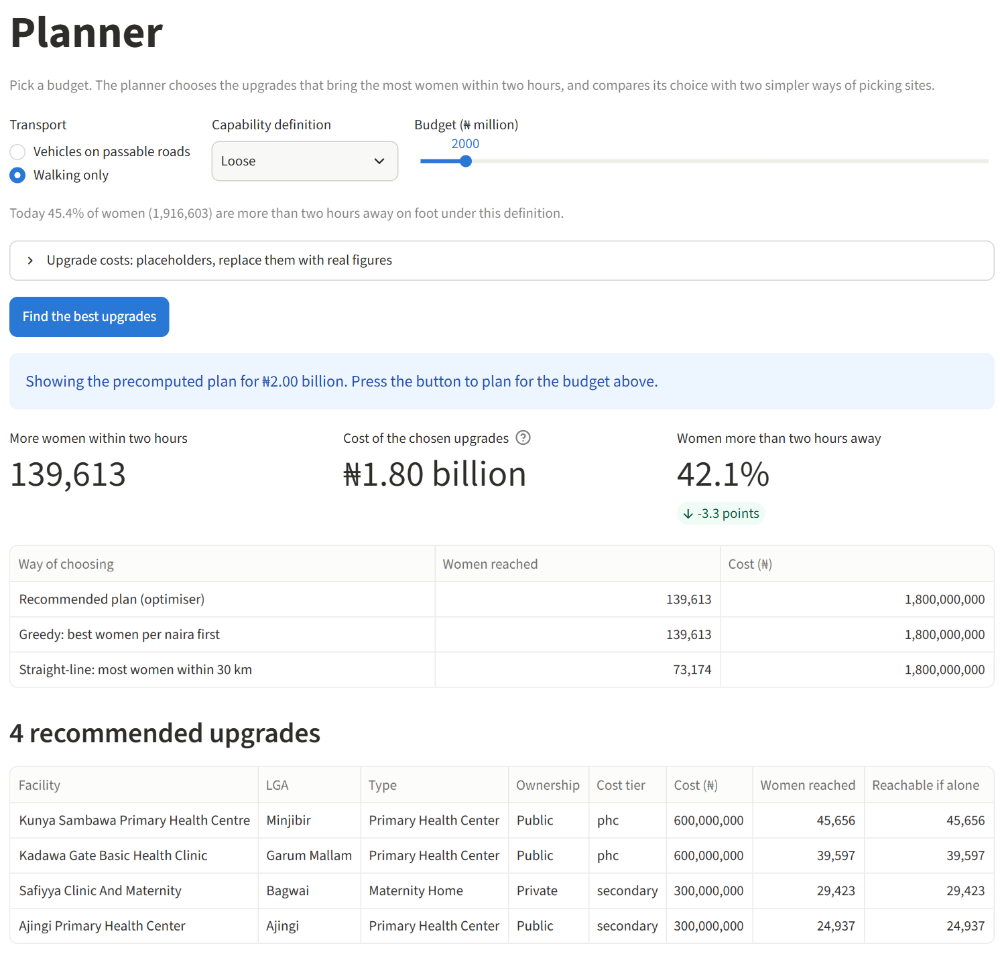
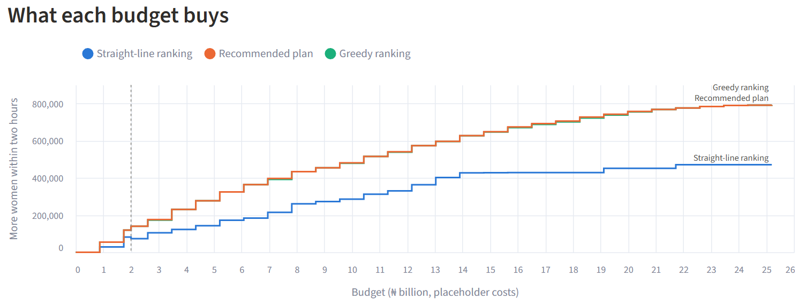
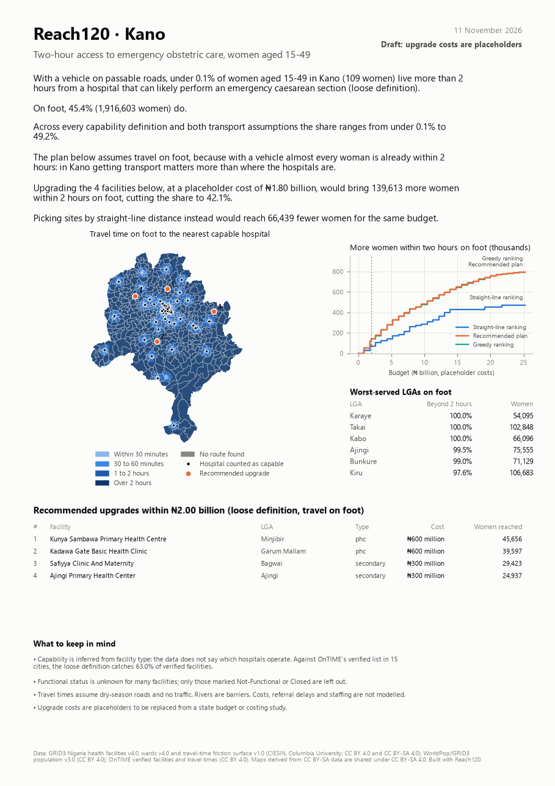
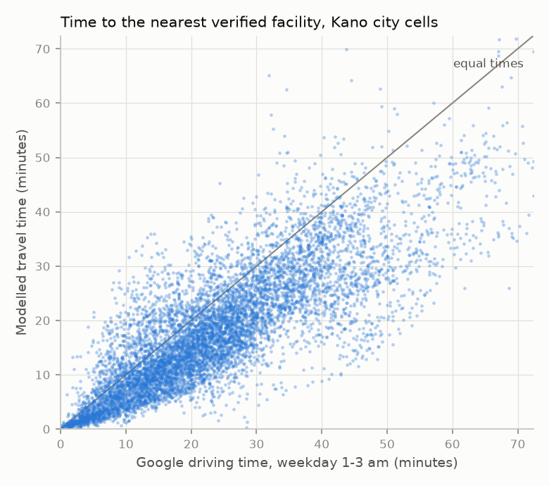
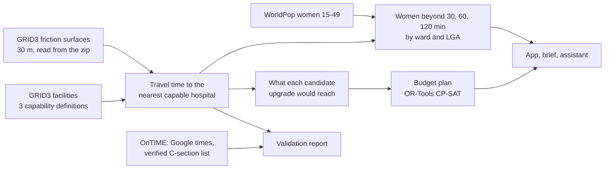

<h1 align="center">Reach120</h1>

<p align="center">
  <b>Every woman within two hours of emergency obstetric care.</b><br>
  Reach120 maps how long women in a Nigerian state take to reach a hospital that can perform an
  emergency caesarean section, then picks which facilities to upgrade, within a budget, to bring
  the most women within two hours.
</p>

<p align="center">
  
  
  
  
  
</p>

<p align="center">
  
</p>
<p align="center"><sub>Kano State, women aged 15-49, travel time computed on a 30 m grid. The orange points are the
four upgrades the planner picks for women travelling on foot.</sub></p>

## Why two hours

Nigeria had about 75,000 maternal deaths in 2023, 28.7% of the world's total. Most deaths from
haemorrhage, eclampsia or obstructed labour can be prevented if the woman reaches a hospital that
can do a caesarean section within about two hours. A state planner needs two answers: who is
beyond that line today, and which upgrades would bring the most of them inside it for the money
available. Reach120 gives both, for any state, from open data, on a laptop.

## What it found in Kano

- **4.22 million women aged 15-49** live in Kano's 484 wards.
- **With a vehicle, almost everyone is close.** On passable roads, 87.5-91.5% of women are within
  30 minutes of a hospital that can likely perform a caesarean section. Only 109 are more than
  two hours away.
- **On foot, about half are not.** 45.4-49.2% of women, 1.9 to 2.1 million, are more than two
  hours' walk away. In Kano, getting a vehicle to a woman in labour matters more than where the
  hospitals are.
- **Choosing sites well doubles what a budget buys.** For ₦2 billion (placeholder costs), the
  best upgrades bring 140,000 to 203,000 more women within two hours on foot. Picking sites by
  straight-line distance reaches 73,000 to 105,000 for the same money.
- **The travel times hold up.** Across 8,502 city cells, modelled times rank the same way as
  Google's driving times (rank correlation 0.82-0.83).

Ranges run across three definitions of which hospitals can do a caesarean, because the data does
not say so directly ([why](#limits)).

## The app

Five pages: an overview of the state, the travel-time map, the planner, an assistant that answers
questions by running the model, and the method with its limits.

<p align="center">
  
</p>
<p align="center"><sub>The Planner. Pick a transport mode, a capability definition and a budget; it returns the upgrades
that reach the most women and compares them with two simpler ways of choosing.</sub></p>

<p align="center">
  
</p>
<p align="center"><sub>What each budget buys, solved exactly at 30 budgets. The best set at a larger budget is not
always the smaller set plus more sites, which is why a simple ranking falls behind.</sub></p>

## The one-page brief

A PDF for each state, built by rule from the results, for people who will never open the app.

<p align="center">
  
</p>

## Do the travel times hold up?

<p align="center">
  
</p>

- **Against Google.** The OnTIME study recorded Google driving times from every city cell to the
  nearest verified facility. Over 8,502 Kano cells, Reach120's times rank the same way
  (rank correlation 0.82-0.83 across eight departure times), are 4.5-5.4 minutes faster at the
  median because the model has no traffic, and fall on the same side of 60 minutes in 96-97% of
  cells.
- **Against road routing in the countryside.** At 50 rural origins, OpenStreetMap routing (OSRM)
  gives a rank correlation of 0.82 and a median difference of 2.2 minutes.
- **Against a verified list of C-section facilities.** Each capability definition is scored on
  how many verified facilities it catches and how many it wrongly counts (see [Limits](#limits)).

## How it works



- **No unzipping.** Each friction surface is a 6.4 GB GeoTIFF inside a zip. A small reader pulls
  just the tiles for the state plus 50 km straight from the zip.
- **Travel time** is a multi-source Dijkstra search over the 8-connected 30 m grid, compiled
  with Numba and capped at the two-hour target. Tests check it against SciPy.
- **Population.** Times go onto WorldPop's 100 m grid as the median of the 30 m cells, so pockets
  that rivers cut off in the surface do not distort the counts.
- **Candidates.** Up to 250 facilities not yet counted as capable, including the best-placed
  primary health centre in each LGA. For each, the search finds which women it would bring within
  two hours, with exact pruning that tests show changes no answer.
- **The plan** is a budgeted maximum-coverage problem, solved exactly with OR-Tools CP-SAT and
  compared with a greedy women-per-naira ranking and a straight-line ranking.
- **The assistant** calls the model's own functions through a free-tier language model (Groq by
  default). It cannot answer from memory, and every number in its reply is checked against the
  tool results it came from.

The full design is in [ARCHITECTURE.md](ARCHITECTURE.md) and the build plan in [PLAN.md](PLAN.md).

## Run it

Python 3.11 or later. The data is about 9.5 GB, downloaded once; the national layers go into a
folder next to the repo (`../00-shared-data`) so other projects can share them.

```bash
git clone https://github.com/Otto-Destiny/reach120.git
cd reach120
python -m venv .venv
source .venv/bin/activate          # Windows: .venv\Scripts\activate
pip install -e ".[dev]"

python scripts/get_data.py --dry-run   # what will be downloaded
python scripts/get_data.py             # about 9.5 GB; resumes if interrupted
reach120 all --state Kano              # every step, about 40 minutes the first time
streamlit run app/streamlit_app.py     # the app, at http://localhost:8501
```

Other states work the same way: `reach120 states` lists them. One step at a time:

| Command | What it does | Kano, on a laptop |
|---|---|---|
| `reach120 prepare --state Kano` | Cuts the state plus 50 km out of the national layers | 6 min the first time, seconds after |
| `reach120 scorecard` | Scores the capability definitions against the verified list (national, once) | 3 min |
| `reach120 travel-time --state Kano` | Travel time for 4 capability definitions × 2 transport modes | 3 min per run |
| `reach120 coverage --state Kano` | Ward, LGA and state tables; map images | 20 s |
| `reach120 reach --state Kano` | Demand points, candidate upgrades and what each would reach | 30 s |
| `reach120 plan --state Kano` | Budget curves and default plans | 15 s |
| `reach120 plan --state Kano --budget 3e9 --mode walk` | One plan for one budget | seconds |
| `reach120 validate --state Kano [--osrm]` | Validation report; `--osrm` adds the rural road-routing check | 4 min the first time |
| `reach120 brief --state Kano` | The one-page PDF | 5 s |
| `reach120 ask --state Kano "Which LGAs are worst served?"` | The assistant, from the command line | seconds |
| `reach120 bundle --state Kano` | A 10 MB folder with a Dockerfile, ready for Hugging Face Spaces | seconds |

Tests: `pytest`. They check the travel-time search against SciPy, that pruning changes no
answer, the zip reader on synthetic BigTIFFs, the optimiser against brute force, the coverage
tables, the name matching, the assistant's number check, and that every app page runs.

### The assistant (free)

Off until you give it a key. Create one at no cost at console.groq.com, then:

```bash
export REACH120_LLM_API_KEY="<your key>"     # PowerShell: $env:REACH120_LLM_API_KEY = "<your key>"
```

Any OpenAI-compatible endpoint works: also set `REACH120_LLM_BASE_URL` and `REACH120_LLM_MODEL`.
Everything else in the app works without a key.

### Changing assumptions

| What | Where |
|---|---|
| Which facility types count as capable | `config/scenarios.yaml` |
| Upgrade costs (placeholders) | `config/costs.yaml`, or the Planner page |
| Two-hour target, thresholds, default budget, solver limits | `config/settings.yaml` |

## Limits

- **Facility type is a weak stand-in for C-section capability.** Against OnTIME's verified list
  in 15 cities, the strict, base and loose definitions catch 6%, 15% and 63% of verified
  facilities, and 58-63% of the facilities each counts as capable are not on the list. Most
  verified facilities are private and typed "Hospital", "Medical Center" or "Clinic". Every
  headline is therefore a range across definitions; the loose one balances best and is the
  default.
- **Functional status is often unknown.** Only facilities marked Not-Functional or Closed are
  left out, and 264 of Kano's 2,122 facility records have no coordinates.
- **Vehicle or foot is the biggest assumption.** "Vehicles on passable roads" assumes a vehicle
  is available at once; "walking only" assumes none. Most women are somewhere in between.
- **The travel-time surface is new** and not yet validated by government. It assumes dry-season
  roads and no traffic, and treats rivers as barriers except at bridges.
- **Upgrade costs are placeholders**, shown as such everywhere, and editable in the Planner.

## Project layout

```
app/                  Streamlit app: Overview, Map, Planner, Ask, Method and limits
src/reach120/         the pipeline and the reach120 command
config/               settings, capability definitions, placeholder upgrade costs
scripts/get_data.py   downloads the open data
tests/                pytest suite
docs/images/          the pictures in this README
```

## Data and credits

| Data | Source | Licence |
|---|---|---|
| Health facilities v4.0, operational boundaries, travel-time friction surface v1.0 | [GRID3 Nigeria](https://grid3.org) | CC BY 4.0; wards and friction surface CC BY-SA 4.0 |
| Population v3.0, total and by age and sex | [WorldPop and GRID3](https://data.worldpop.org/repo/wopr/NGA/population/v3.0/) | CC BY 4.0 |
| Verified C-section facilities and Google travel times | OnTIME: [facilities](https://doi.org/10.6084/m9.figshare.22689667.v2), [travel times](https://doi.org/10.6084/m9.figshare.22699759.v1) | CC BY 4.0 |

Maps and images derived from CC BY-SA data are shared under CC BY-SA 4.0. App map tiles
© CARTO, map data © OpenStreetMap contributors. Details and download sizes:
[data/README.md](data/README.md).
